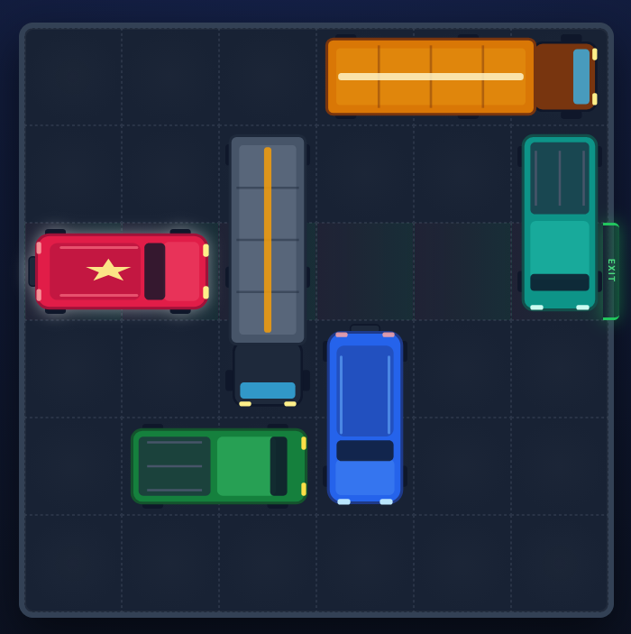

# Block Power

A sliding-block puzzle for the browser. Slide the jeeps and trucks along their lanes to clear a path, then drive the **Red Jeep** out through the exit on the right wall.

**▶ Play it in your browser: https://rarmknecht.github.io/BlockPower/**

It works on phones, tablets, and desktops, with nothing to install.

<p align="center">
  
</p>

- 20 puzzles in four tiers (Starter, City Grid, Freight Yard, Master Jam), on 6×6 up to 7×8 lots
- Every par is the true optimal move count, computed by a breadth-first solver
- Hint button shows the next optimal move from wherever you are
- Touch, mouse, and full keyboard play
- No dependencies, no build step, no network requests; progress is saved only in your browser

## Play locally

The game uses ES modules, so it needs to be served over HTTP rather than opened as a file:

```sh
python3 -m http.server 8000
# then open http://localhost:8000
```

Any static host works the same way (GitHub Pages, Netlify, etc.).

## Controls

| Input | Action |
| --- | --- |
| Drag | Slide a vehicle along its lane |
| `Tab` / `Shift`+`Tab` | Select the next / previous vehicle |
| Arrow keys or `WASD` | Slide the selected vehicle one space |
| `Shift` + arrow | Slide as far as it will go |
| `H` | Hint |
| `U` or `Ctrl`+`Z` | Undo |
| `Esc` | Close dialogs |

A slide of any distance counts as one move, and consecutive keyboard slides of the same vehicle are merged into a single move.

## Vehicles

The Red Jeep is always red. Every other vehicle gets a random color, so tell them apart by shape and length:

- **Jeeps** (2 spaces): compact 4×4s with a spare tire on the back
- **Residential trucks** (2 or 3 spaces): pickups and utility vans with an open cargo bed
- **Commercial trucks** (3 spaces): freight haulers with a ribbed cargo box

## Project layout

```
index.html            App shell and dialogs
css/style.css         Styles
js/app.js             UI, input handling, progress
js/engine.js          Board model, slide bounds, move validation, win check
js/solver.js          BFS solver (par verification and hints)
js/levels.js          Level data
js/vehicles.js        SVG vehicle artwork
js/audio.js           Web Audio sound effects (synthesized, no audio files)
tests/verify.mjs      Validates every level and checks its par
tools/generate-level.mjs  Generates new levels
docs/screenshot.png   README screenshot
```

## Tests

```sh
node tests/verify.mjs
```

This checks that every level is valid, solvable, has the correct optimal par, can be solved within the in-game Hint search budget, and has a unique id and name.

## Adding levels

`tools/generate-level.mjs` builds a random board, explores every reachable position, and picks the one farthest from a solution:

```sh
node tools/generate-level.mjs '{"rows":6,"cols":6,"exitRow":2,"minN":10,"maxN":12,"minPar":15,"maxPar":18,"seconds":120}'
```

It prints a level as JSON. Add an `id`, `name`, and `difficulty`, append it to `js/levels.js`, and run the tests.

## License

Block Power is dedicated to the public domain under [CC0 1.0 Universal](LICENSE). You can copy, modify, and distribute it, including for commercial use, without asking permission or giving credit.
